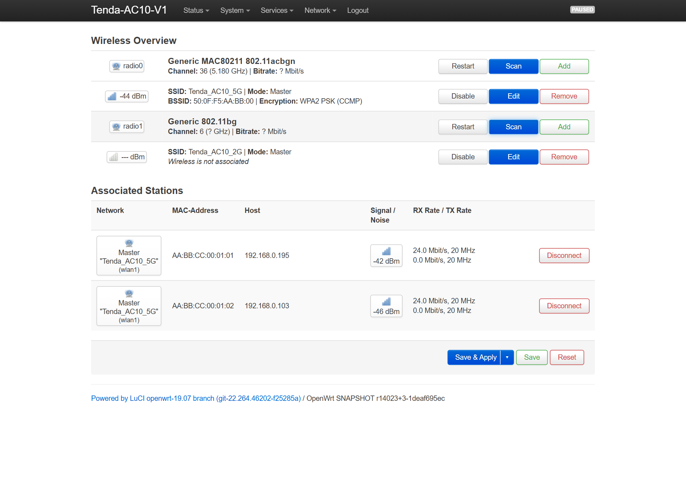
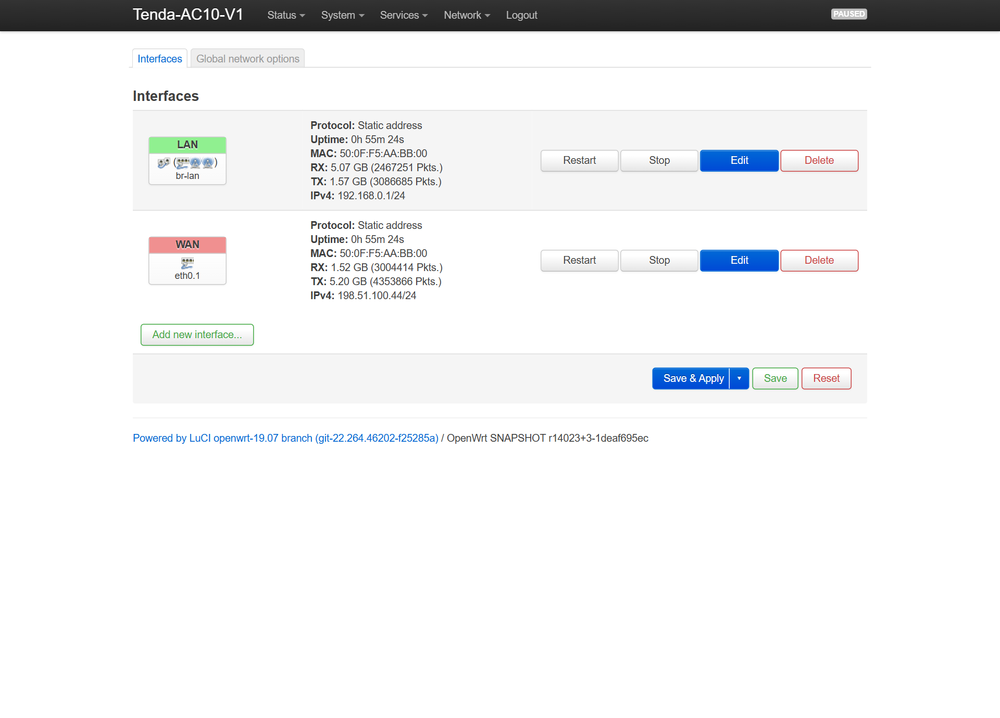
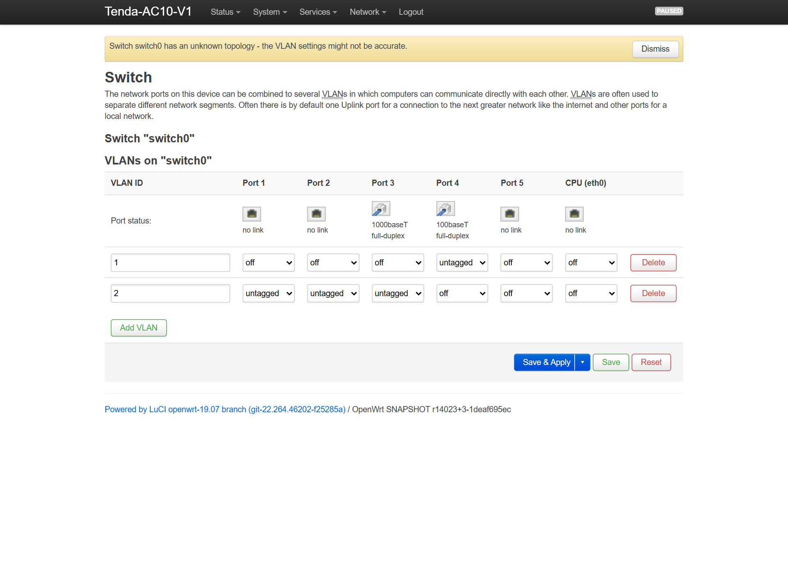
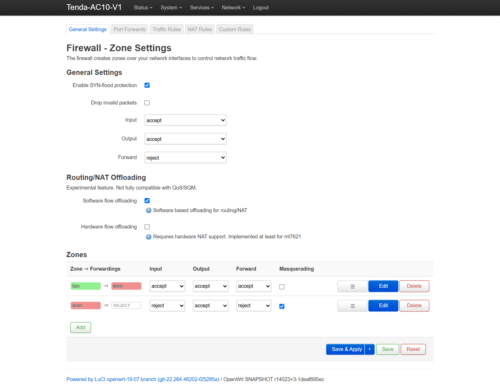

# Tenda AC10 V1.0 — Hybrid OpenWrt 4.14.187, Скрипты автонастройки и TFTP-раскирпичивание (RU / EN)

[](https://github.com/ccsimplyspolit/tenda-ac10-v1-hybrid-openwrt/actions/workflows/build-ac10-hybrid-openwrt.yml) [](https://ccsimplyspolit.github.io/tenda-ac10-v1-hybrid-openwrt/)

> **СТОП — сначала проверьте наклейку на дне роутера! / CHECK YOUR STICKER FIRST!**  
> Прошивка подходит **только для Tenda AC10 ревизии V1.0** (стоковая прошивка `V15.03.06.xx`, FCC ID `V7TAC10`, 8 МБ Flash / 64 МБ RAM).  
> На ревизиях **V2.0 и V3.0** (`V02.03.xx` / `V03.03.xx`, чип `RTL8197FH`, система eCos и флешка всего на 2 МБ) заливка любого Linux-образа мгновенно убьёт загрузчик — поднять такой роутер без выпаивания флешки уже не выйдет.

---

## Зачем вообще этот репозиторий (RU) | Why This Exists (EN)

**RU:** У Tenda AC10 V1.0 бодрое для своего класса железо (`Realtek RTL8197FS` 1 ГГц, гигабитный свитч `RTL8367RB` и честный 5 ГГц чип `RTL8822BE`), но родная прошивка забита китайским облаком `ucloud_v2`, открытыми дырами вроде `/cgi-bin/DownloadFlash` и кривым мостом `br2`. А попытки накатить чистый OpenWrt упирались то в пустой заводской eFuse (`0xFF`) на 5 ГГц с падением сигнала на 17 дБ, то в мёртвые порты свитча, то в «Подключено, без доступа к интернету» по Wi-Fi из-за аппаратного NAT, то в ругань iPhone на заблокированный DNS.

Мы собрали **гибридный OpenWrt 4.14.187 (юзерспейс OpenWrt 19.07 + LuCI на привычном `192.168.0.1`)**, обкатали его на живом роутере под реальным провайдером с привязкой по MAC, закрыли все 14 найденных граблей прямо внутри образа и написали автономные скрипты для Windows — чтобы прошиться и перенести настройки провайдера в пару кликов, даже когда интернета под рукой нет.

**EN:** Tenda AC10 V1.0 has capable silicon (`RTL8197FS` 1 GHz, `RTL8367RB` GbE switch, `RTL8822BE` 802.11ac), but stock firmware ships with `ucloud_v2` telemetry and unauthenticated flash-dump endpoints, while plain OpenWrt builds suffered from blank `0xFF` OTP eFuse (`-17 dB` 5 GHz signal), wrong switch ports, `hwnat=1` Wi-Fi blackholes, and iOS encrypted-DNS warnings. This repo ships a live-tested **Hybrid OpenWrt 4.14.187** build (`LuCI` on `192.168.0.1`) with all 14 hardware/network fixes baked in, plus 1-click offline TFTP flashers and an automated ISP/Wi-Fi migrator.

- **Скачать готовые файлы / Download Releases:** [**GitHub Releases (`v4.14.187-r3-ac10-hybrid`)**](https://github.com/ccsimplyspolit/tenda-ac10-v1-hybrid-openwrt/releases/latest)
- **Полное русское руководство:** [**README_RU.md**](README_RU.md) | **Пост на 4PDA (#3585):** [**Открыть тему 4PDA**](https://4pda.to/forum/index.php?showtopic=885989&view=findpost&p=145799909)
- **Разбор всех 19 проблем, стресс-теста 2000 МБ и план `r3`:** [**Пост-мортем + План `r3` (RU)**](docs/openwrt_hybrid/ENGINEERING_POSTMORTEM_ALL_PROBLEMS_AND_SOLUTIONS_RU.md) | [**Post-Mortem & `r3` Roadmap (EN)**](docs/openwrt_hybrid/ENGINEERING_POSTMORTEM_ALL_PROBLEMS_AND_SOLUTIONS_EN.md)
- **Документация и Wiki:** [**GitHub Pages**](https://ccsimplyspolit.github.io/tenda-ac10-v1-hybrid-openwrt/) | [**GitHub Wiki (RU / EN)**](https://github.com/ccsimplyspolit/tenda-ac10-v1-hybrid-openwrt/wiki)

---

## Живая панель LuCI на прошитом роутере | Live LuCI Web Panel Screenshots

Так выглядит веб-интерфейс `http://192.168.0.1` сразу после прошивки и автопереноса настроек (реальные IP/MAC провайдера на скриншотах заменены на тестовые):

| Сводка системы (`Status -> Overview`) | Радиомодули 5 ГГц и 2.4 ГГц (`Network -> Wireless`) |
|---|---|
|  |  |

| Интерфейсы LAN / WAN (`Network -> Interfaces`) | Гигабитный свитч RTL8367RB (`Network -> Switch`) |
|---|---|
|  |  |

| Межсетевой экран и Software Flow Offloading (`Network -> Firewall`) |
|---|
|  |

---

## Готовые скрипты и утилиты | Ready-to-Use Scripts & Toolkit

Все скрипты работают офлайн на чистой Windows 10/11 (без `pip` и без включения компонента Windows `tftp.exe`) и в блоке `finally` всегда возвращают сетевую карту ПК обратно в DHCP, даже если окно закрыли по `Ctrl+C`:

| Скрипт / Файл | Что делает (RU / EN) | Когда запускать |
|---|---|---|
| [**`offline_autonomous_tools/Flash_Hybrid_OpenWrt_4.14_TFTP.bat`**](offline_autonomous_tools/Flash_Hybrid_OpenWrt_4.14_TFTP.bat) | Сам ставит временный IP `192.168.1.116`, ловит загрузчик на `192.168.1.6:69` по ARP/UDP, заливает `factory.bin` за 7 секунд, ждёт перезагрузки и возвращает ПК на DHCP. | Прошивка OpenWrt в 1 клик или раскирпичивание (кабель в **LAN 1–3**, не в WAN!). |
| [**`offline_autonomous_tools/Configure_OpenWrt_ISP_WAN_and_WiFi.bat`**](offline_autonomous_tools/Configure_OpenWrt_ISP_WAN_and_WiFi.bat) | Читает ваш стоковый бэкап `RouterCfm.cfg` и по локальному SSH за 10 секунд переносит в OpenWrt клонированный MAC провайдера, статику/DHCP WAN, DNS, имена и пароли Wi-Fi и привязки IP. | Сразу после первого старта OpenWrt (`192.168.0.1`), чтобы интернет заработал без ручной возни. |
| [**`offline_autonomous_tools/Offline_TFTP_Recovery_and_Flash.bat`**](offline_autonomous_tools/Offline_TFTP_Recovery_and_Flash.bat) | Проверяет контрольные суммы, блокирует опасные двухсегментные `cs6c+hsqs` образы и откатывает роутер на чистый заводской сток `V15.03.06.23` по TFTP. | Если захотели вернуться обратно на родную прошивку Tenda. |
| [**`offline_autonomous_tools/Restore_Optimized_Config_and_WAN.bat`**](offline_autonomous_tools/Restore_Optimized_Config_and_WAN.bat) | Заливает на стоковую прошивку очищенный конфиг `Stock+` (без китайского облака `ucloud_v2`, без фантомного моста `br2`, с фиксом торрентов). | После отката на сток, чтобы убрать телеметрию и вернуть MAC провайдера. |
| [**`offline_autonomous_tools/Emergency_Restore_PC_Network_DHCP.bat`**](offline_autonomous_tools/Emergency_Restore_PC_Network_DHCP.bat) | За 3 секунды сбрасывает застрявший статический IP (`192.168.1.x`) на сетевой карте ПК обратно в автоматический DHCP + DNS. | Если во время ручных экспериментов мигнул свет или закрыли терминал. |
| [**`build_hybrid_openwrt_ac10.sh`**](build_hybrid_openwrt_ac10.sh) | Полный сборочный скрипт прошивки `r3`: собирает DTB, патчит `vmlinux` (34 патча свитча, `SBFCR1`, `trunk_pause=3`, `ToCpu`), `rtw88_8822b.ko` (`RFE Type 6` + `VHT80` reg `0x33` + `REG_L1WT`) и `rtw88_core.ko` (`DESC_RATE6M`), упаковывает `factory.bin`, `sysupgrade.bin` и `webupgrade.bin`. | Для самостоятельной пересборки образа на Ubuntu / WSL2 или в GitHub Actions. |
| [**`tools/scripts/set-mib.sh`**](tools/scripts/set-mib.sh) | Скрипт предзагрузки внутри роутера: вытаскивает из `/dev/mtd1` заводской `HW_NIC0_ADDR` и подстройку кварца `HW_WLAN0_11N_XCAP` для 5 ГГц и 2.4 ГГц. | Уже вшит в прошивку (`/bin/set-mib.sh`), выложен отдельно для изучения и доработок. |

> Скачать весь набор скриптов одним архивом можно со страницы релиза: [**`Tenda_AC10_V1_Offline_Autonomous_Toolkit.zip`**](https://github.com/ccsimplyspolit/tenda-ac10-v1-hybrid-openwrt/releases/latest). Подробное описание всех ключей запуска — в [**`offline_autonomous_tools/README_OFFLINE_TOOLS.md`**](offline_autonomous_tools/README_OFFLINE_TOOLS.md).

---

## Быстрая прошивка: два проверенных способа (RU)

### Способ 1: Прямо из родного меню Tenda через браузер (без TFTP)
1. Подключите ПК кабелем в жёлтый порт **LAN 1** или **LAN 2** (по Wi-Fi шить не надо).
2. Откройте `http://192.168.0.1` -> *Системные настройки* -> *Обновление прошивки*.
3. Выберите файл [**`tenda-ac10-v1-hybrid-openwrt-4.14-webupgrade.bin`**](02_Compiled_Hybrid_OpenWrt_4.14_Firmware/tenda-ac10-v1-hybrid-openwrt-4.14-webupgrade.bin) (`5,681,862` Б, с 64-байтным заголовком `trx2` `0x00030028` — штатная проверка не выдаст `"Format error!"`).
4. Подождите **90–120 секунд**: при первом запуске скрипт `80_mount_root` сам очистит хвосты стокового SquashFS в `mtd5` и разметит чистый раздел `JFFS2` под настройки. После этого панель LuCI откроется на **`http://192.168.0.1`** (логин `root`, пароль пустой).

### Способ 2: В 1 клик через загрузчик по TFTP (рекомендуется, поднимает из любого состояния)
1. Вставьте кабель от ПК в **LAN 1, LAN 2 или LAN 3** (**не в синий WAN!** Загрузчик при старте физически обесточивает порт WAN).
2. Запустите от имени Администратора [`offline_autonomous_tools/Flash_Hybrid_OpenWrt_4.14_TFTP.bat`](offline_autonomous_tools/Flash_Hybrid_OpenWrt_4.14_TFTP.bat) (или `Offline_TFTP_Recovery_and_Flash.bat` для возврата на сток).
3. На выключенном роутере зажмите скрепкой кнопку **RST/WPS**, воткните питание 12V, подержите **7–10 секунд** до частого мигания `SYS` и отпустите.
4. Не пытайтесь пинговать `192.168.1.6` вручную — в загрузчике Realtek вообще нет обработчика ICMP, он отвечает только на ARP и UDP порт 69. Скрипт сам зальёт [`factory.bin`](02_Compiled_Hybrid_OpenWrt_4.14_Firmware/tenda-ac10-v1-hybrid-openwrt-4.14-factory.bin), дождётся перезагрузки и вернёт вашу сетевую карту в DHCP.
5. Если провайдер привязан к MAC-адресу старого роутера, положите свой бэкап `RouterCfm.cfg` рядом и запустите [`Configure_OpenWrt_ISP_WAN_and_WiFi.bat`](offline_autonomous_tools/Configure_OpenWrt_ISP_WAN_and_WiFi.bat) — интернет и ваши сети Wi-Fi поднимутся сами.

---

## Quick Start: Flashing & ISP Migration (EN)

### Option 1: Direct Upgrade from Stock Tenda Web UI
1. Plug an Ethernet patch cord into yellow **LAN 1 or LAN 2**, open `http://192.168.0.1` -> *System Settings* -> *Firmware Upgrade*.
2. Upload [**`tenda-ac10-v1-hybrid-openwrt-4.14-webupgrade.bin`**](02_Compiled_Hybrid_OpenWrt_4.14_Firmware/tenda-ac10-v1-hybrid-openwrt-4.14-webupgrade.bin) (`5,681,862` B, carries the `0x00030028` `trx2` header expected by `libcommon.so`).
3. Give the first boot **90–120 seconds** to format a clean `JFFS2` overlay over `mtd5`, then sign in to LuCI at **`http://192.168.0.1`** (`root`, empty password).

### Option 2: 1-Click Bootloader TFTP Flash (Also Unbricks Any Soft-Brick)
1. Plug your PC cable into **LAN 1, LAN 2, or LAN 3** (**never blue WAN** — Realtek Booter powers down Switch Port 3 PHY on boot).
2. Right-click -> **Run as Administrator**: [`offline_autonomous_tools/Flash_Hybrid_OpenWrt_4.14_TFTP.bat`](offline_autonomous_tools/Flash_Hybrid_OpenWrt_4.14_TFTP.bat) (or `Offline_TFTP_Recovery_and_Flash.bat` for clean stock Tenda `V15.03.06.23`).
3. Hold **RST/WPS**, plug in 12V power, keep holding **7–10 seconds**, then release. (Note: `ping 192.168.1.6` never replies because the bootloader drops all non-UDP packets at `0x80001010` — our script probes ARP + UDP:69 directly.)
4. Once OpenWrt boots at `192.168.0.1`, run [`Configure_OpenWrt_ISP_WAN_and_WiFi.bat`](offline_autonomous_tools/Configure_OpenWrt_ISP_WAN_and_WiFi.bat) to migrate your ISP cloned WAN MAC, WAN IP/DNS, static DHCP leases, and Wi-Fi SSIDs/passwords from `RouterCfm.cfg` over local SSH.

---

## Честно о том, как всё работает сейчас | Honest Status & Numbers (`Stock+` vs `OpenWrt r3`)

- **Какую прошивку выбрать (`Hybrid OpenWrt 4.14.187 r3` vs `Stock+`):**
  - **`Hybrid OpenWrt 4.14.187 (r3)` — полноценная откалиброванная сборка с LuCI, SSH, VLAN, аппаратным ускорением и широким каналом `VHT80` (80 МГц):** в ревизии `r3` закрыты все ограничения прошлых сборок — пропатчены модули `rtw88_8822b.ko` и `rtw88_core.ko` для стабильной работы **`VHT80` (80 МГц, до 866.7 Мбит/с PHY, 200–450+ Мбит/с реальных)** без отвалов на `B-cut` кремнии, добавлена полная калибровка 2.4 ГГц (`SKY85303-11` PA/LNA + `disable_txsc=1` + `amsdu=1`), включён совместный аппаратный + программный оффлоадинг (`hwnat=1` + `wan_route_mode=1` `ToCpu` + `flow_offloading_hw=1`), асимметричный контроль потока (`trunk_pause=3`), расширенные пороги буфера `SBFCR1` (`320/380`) и двухступенчатый сторожевой таймер без сбросов `SIRR FULL_RST` под нагрузкой 2000+ МБ.
  - **Профиль `Stock+` (`V15.03.06.23` + `Restore_Optimized_Config_and_WAN.bat`) — для тех, кто привык к родному веб-интерфейсу Tenda:** заводской драйвер `rtl8192cd` с полосой **`VHT80` (80 МГц)**, Beamforming и аппаратным `fastpath`, в котором полностью отключены китайское облако `ucloud_v2` и паразитный мост `br2`. Полный технический разбор всех 19 проблем и решений `r3` описан в [**Пост-мортеме и Архитектуре `r3`**](docs/openwrt_hybrid/ENGINEERING_POSTMORTEM_ALL_PROBLEMS_AND_SOLUTIONS_RU.md).
- **Маршрутизация в OpenWrt `r3` (Провод + Wi-Fi на полной скорости):** В ревизии `r3` пропатчен бит `WANRouteMode=ToCpu` (`SWTCR0 |= 0x400C`) в `gw_prog` и добавлен событийный сброс L2-таблицы (`dir842-l2flush`), благодаря чему **аппаратный NAT (`hwnat=1`) и `Software/Hardware Flow Offloading` работают одновременно и для кабеля (до 940 Мбит/с), и для клиентов Wi-Fi** без «чёрной дыры» на смартфонах.
- **Wi-Fi 5 ГГц (`RTL8822BE` + усилители Skyworth `SE5003L1` RFE Type 6):** В OpenWrt `r3` работает на полной мощности **23 dBm (200 мВт)** с заводской подстройкой кварца `XCAP` из `mtd1` на широкой полосе **`VHT80` (80 МГц), канал `36` (`149` резервный)**: время ожидания калибровки RF-регистра `0x33` для 1x1 и 2x2 увеличено в 10 раз (`100 -> 1000` итераций / `2 мс`), активирован порог `REG_L1WT` (`0x9194b2b9`) для `RFE Type 6 B-cut`, а управляющие и EAPOL-кадры зафиксированы на `DESC_RATE6M` (`6 Мбит/с OFDM` вместо `1 Мбит/с CCK`).
- **Wi-Fi 2.4 ГГц (`RTL8197FS` + усилители Skyworks `SKY85303-11` RFE Type 5):** В `/bin/set-mib.sh` добавлена побайтовая подгрузка заводских таблиц мощности `pwrlevelCCK_A/B`, `pwrlevelHT40_1S_A/B`, `ther`, `regdomain` и `trswitch` из раздела `calibration` (`mtd1`), включена агрегация `ampdu=1` + `amsdu=1` и отключён дефектный TX-shortcut (`disable_txsc=1`), вызывавший потерю пакетов под нагрузкой.
- **Apple iOS / macOS и безопасность WAN:** Убран мусорный `ula_prefix` IPv6 и настроен DHCP Option 6 (`1.1.1.1, 8.8.8.8, 192.168.0.1`) под RFC 9462 DDR — iPhone сразу уходит на быстрый HTTP/3 DoH. Сокеты `uhttpd` и `dnsmasq` жёстко отвязаны от WAN (`eth0.1`), а WPS отключён на уровне прошивки.
---

## Карта репозитория | Repository Layout

1. [**`02_Compiled_Hybrid_OpenWrt_4.14_Firmware/`**](02_Compiled_Hybrid_OpenWrt_4.14_Firmware/) — Готовые образы `r3`: `factory.bin` (TFTP), `sysupgrade.bin` (LuCI), `webupgrade.bin` (из стока Tenda) и `tenda-ac10-v1.dtb`.
2. [**`offline_autonomous_tools/`**](offline_autonomous_tools/) — Скрипты прошивки в 1 клик, автопереноса настроек провайдера/Wi-Fi, отката на сток и 40 автотестов проверки (`Test_Offline_Autonomous_Tools_Loopback.py`).
3. [**`01_Stock_Firmware_and_Partitions/`**](01_Stock_Firmware_and_Partitions/) — Стоковый TFTP-образ `V15.03.06.23_multi`, эталонные дампы `mtd0`–`mtd3` (обезличенные), таблица `kallsyms` и шаблон конфига `Stock+`.
4. [**`03_Reverse_Engineering_and_Forensic_Analysis/`**](03_Reverse_Engineering_and_Forensic_Analysis/) — Дизассемблирование `Realtek Booter v3.4.11B.9`, разбор бага `$s7=0`, `RTL8367RB`, `RTL8822BE` eFuse и скрипты распаковки `Tenda SquashFS-XZ`.
5. [**`docs/`**](docs/) & [**`wiki/`**](wiki/Home.md) — Скриншоты панели (`docs/images/`), инженерный пост-мортем всех 14 проблем и двуязычная база знаний.

## Контрольные суммы | SHA-256 Checksums (`v4.14.187-r3-ac10-hybrid`)

```text
88dd65babeead765efbd9d46d8dd13a8588b671392838962f26be18119316e81  tenda-ac10-v1-hybrid-openwrt-4.14-factory.bin
88dd65babeead765efbd9d46d8dd13a8588b671392838962f26be18119316e81  tenda-ac10-v1-hybrid-openwrt-4.14-sysupgrade.bin
ad3e4ab89548e0c32f98d6c80f24cdbb691ec027dd791a6dd82ebd0919e3014b  tenda-ac10-v1-hybrid-openwrt-4.14-webupgrade.bin
f5c7d1755689dd5319420289d8ebd4e661d418f56d99b775f6111c48a3c96345  tenda-ac10-v1.dtb
a7d4d27f7b1d52526e24348a6a21c5a56740d41b357b17c9e3bc4d8db9f9b0fa  Tenda_AC10_V1_Stock_TFTP_Recovery.bin
e3064eb3c007998d261b6fb4668450e219552d0120e198018e0fe67511f62608  Tenda_AC10_V1_Offline_Autonomous_Toolkit.zip
20e155d62a6843151de145588148f89a364a3a003db3e59116e9be239ac64228  Tenda_AC10_V1_Build_and_Router_Scripts.zip
```
