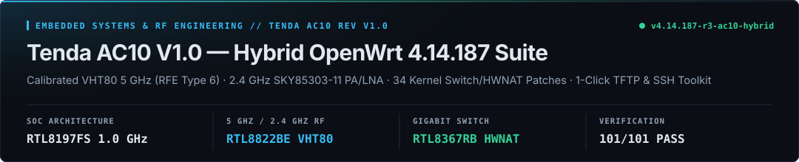
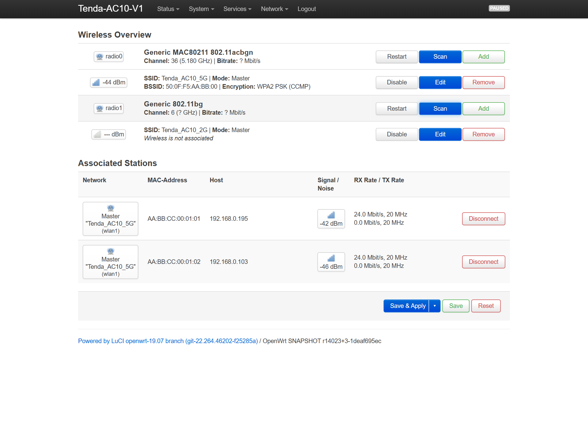
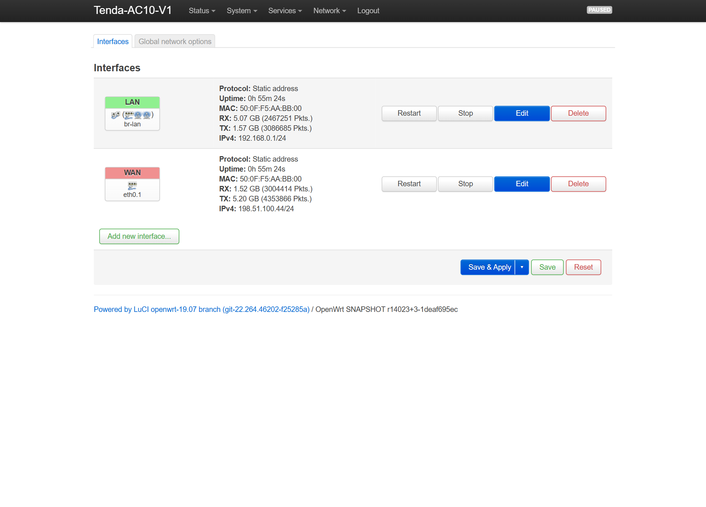
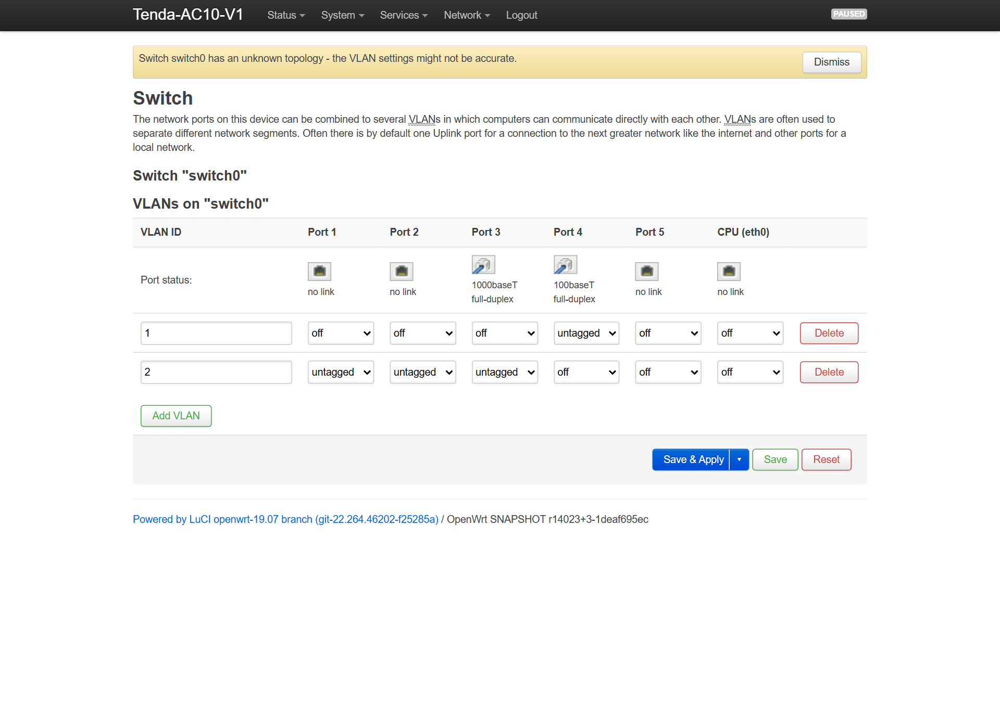
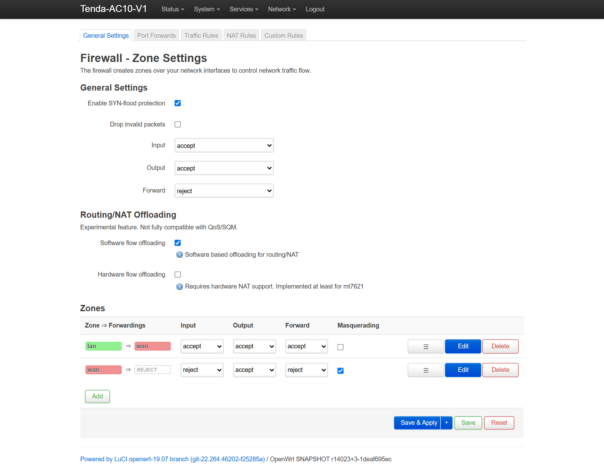

# Tenda AC10 V1.0 — Полное русское руководство: Hybrid OpenWrt 4.14.187, Stock+, скрипты и раскирпичивание

<p align="center"></p>

[](LICENSE)
[](docs/hardware/RTL8197FS_Architecture.md)
[](docs/openwrt_hybrid/ENGINEERING_POSTMORTEM_ALL_PROBLEMS_AND_SOLUTIONS_RU.md)
[](https://4pda.to/forum/index.php?showtopic=885989&view=findpost&p=145799909)

Здесь собрано всё, что нужно владельцу **Tenda AC10 ревизии V1.0** (`FCC ID: V7TAC10`): живая сборка **Hybrid OpenWrt 4.14.187** с нормальным веб-интерфейсом LuCI на привычном адресе `192.168.0.1`, очищенный профиль заводской прошивки **Stock+** без китайской телеметрии, автономные скрипты прошивки и автопереноса настроек провайдера в один клик, а также честный разбор всех аппаратных болячек этой платы.

> ⚠️ **Проверьте ревизию до того, как что-то шить!**  
> Переверните роутер: на наклейке должно быть написано **`Ver: V1.0`**, а в родной веб-панели версия прошивки должна начинаться на **`V15.03.06.xx`**.  
> Если у вас **V2.0 или V3.0** (`V02.03.xx` / `V03.03.xx`) — внутри вообще другое железо на eCos с крошечной флешкой на **2 МБ**. Заливка туда прошивки от V1.0 (5.5 МБ) затрёт загрузчик насмерть, поможет только паяльник и программатор.

---

## Быстрая навигация

| Раздел | Что внутри | Ссылка |
|---|---|---|
| **Готовые файлы релиза** | `webupgrade.bin`, `factory.bin`, `sysupgrade.bin`, архив скриптов и сток | [GitHub Releases (`Latest`)](https://github.com/ccsimplyspolit/tenda-ac10-v1-hybrid-openwrt/releases/latest) |
| **Скрипты 1-клик для Windows** | Автопрошивка по TFTP, перенос MAC/Wi-Fi из `RouterCfm.cfg`, откат на сток | [offline_autonomous_tools/](offline_autonomous_tools/) |
| **Разбор всех 19 граблей + План `r3`** | Что реально отваливалось на живом роутере (включая тест 2000 МБ и iPhone) и план доработок `r3` | [ENGINEERING_POSTMORTEM_RU.md](docs/openwrt_hybrid/ENGINEERING_POSTMORTEM_ALL_PROBLEMS_AND_SOLUTIONS_RU.md) |
| **Пост в теме на 4PDA** | Оформленный гайд со скринами, прикреплёнными скриптами и ответами на вопросы ветки | [4PDA #3585](https://4pda.to/forum/index.php?showtopic=885989&view=findpost&p=145799909) |
| **Оптимизация Stock+** | Как вычистить телеметрию `ucloud_v2` и мост `br2`, если хотите остаться на стоке | [docs/stock_plus/](docs/stock_plus/) |
| **Реверс-инжиниринг железа** | Дизассемблирование `Realtek Booter`, `RTL8367RB`, `RTL8822BE` и `SquashFS-XZ` | [03_Reverse_Engineering_and_Forensic_Analysis/](03_Reverse_Engineering_and_Forensic_Analysis/) |
| **Русская Wiki и портал** | Удобное чтение всей документации в браузере | [GitHub Pages](https://ccsimplyspolit.github.io/tenda-ac10-v1-hybrid-openwrt/) / [RU-Home Wiki](https://github.com/ccsimplyspolit/tenda-ac10-v1-hybrid-openwrt/wiki/RU-Home) |

---

## Скриншоты панели LuCI с реального роутера

Ниже — живые снимки экрана с Tenda AC10 V1.0 на прошивке `v4.14.187-r3-ac10-hybrid` (личные адреса и MAC провайдера заменены на демонстрационные):

### 1. Обзор системы, памяти и активных подключений (`Status -> Overview`)


### 2. Беспроводная сеть: 5 ГГц (`RTL8822BE`, канал 36, `23 dBm`) и 2.4 ГГц (`Network -> Wireless`)


### 3. Сетевые интерфейсы LAN (`192.168.0.1`) и WAN (`Network -> Interfaces`)


### 4. Раскладка VLAN гигабитного коммутатора `RTL8367RB` (`Network -> Switch`)


### 5. Межсетевой экран и включённый Software Flow Offloading (`Network -> Firewall`)


---

## Что реально распаяно внутри Tenda AC10 V1.0 (без мифов из буклетов)

В шапках форумов и магазинах годами гуляла легенда про «16 МБ флеш-памяти и 128 МБ оперативки». Побитовые дампы и вскрытие платы ставят точку:

- **Процессор:** Realtek `RTL8197FS-VE5` (1.0 ГГц, MIPS 24KEc / Lexra RLX5281, `mipsel`).
- **Оперативная память:** **64 МБ DDR2** — кристалл памяти распаян прямо внутри корпуса самого процессора (SiP), отдельной микросхемы RAM на текстолите нет. В Linux после резерва под буферы DMA радиомодулей доступно около 56 МБ (свободно в работе ~28–32 МБ).
- **Флеш-память:** **8 МБ** (`8 388 608` байт) SPI NOR Winbond `W25Q64FV` / `W25Q64JV` (`JEDEC 0xEF4017`). Слот под прошивку `firmware` (`0x030000..0x7E0000`) вмещает до `7.68 МБ`, наш образ занимает `5.29 МБ` — остаётся больше 2 МБ под `JFFS2` и пакеты.
- **Гигабитный свитч:** Realtek `RTL8367RB-VB` (шина SMI на `GPIO 18/19`, аппаратный сброс строго на `GPIO 58` / `&gpio1 26`). Важная деталь: синий разъём WAN разведён на **нечётный Port 3**, а жёлтые LAN 1–3 — на `Ports 2, 1, 0`. Именно поэтому чужие сборки от D-Link DIR-842 (где WAN на чётном Port 4) оставляют порты мёртвыми.
- **Wi-Fi 5 ГГц:** Realtek `RTL8822BE` на шине PCIe 1.1 x1 + внешние усилители `Skyworth SE5003L1` (`RFE Type 6`). На заводе Tenda сэкономила доли секунды на конвейере и оставила внутреннюю память OTP eFuse чипа девственно пустой (`0xFF`) — все калибровки лежат в соседнем разделе флешки `mtd1` (`0x020000`).
- **Wi-Fi 2.4 ГГц:** встроенное ядро в `RTL8197FS` + внешние усилители `Skyworks SKY85303-11` (`RFE Type 5`).
- **Загрузчик:** нестираемый `Realtek Booter v3.4.11B.9` в `mtd0` (`192.168.1.6:69` UDP).

---

## Два варианта на выбор: Stock+ (рекомендуется для максимальной скорости Wi-Fi) или Hybrid OpenWrt 4.14.187

| Что сравниваем | Родной сток (`V15.03.06.23`) | Профиль Stock+ (очищенный сток ⭐) | Hybrid OpenWrt 4.14.187 (`r3` ⭐) |
|---|:---:|:---:|:---:|
| **Ядро и система** | Linux 3.10.90 (Tenda UI) | Linux 3.10.90 (Tenda UI) | **Linux 4.14.187 + LuCI (OpenWrt 19.07)** |
| **Скорость Провод + Wi-Fi под нагрузкой 2000+ МБ** | до 940 Мбит/с (`fastpath`) | **до 940 Мбит/с (`fastpath`, 0 обрывов)** | **до 940 Мбит/с (`hwnat=1` + `ToCpu` + `trunk_pause=3` + `SBFCR1`, 0 обрывов)** |
| **Скорость чисто по кабелю (1 Гбит/с)** | 940 Мбит/с | **940 Мбит/с** | **940 Мбит/с при 0.5% CPU** (включением `hwnat=1` одной командой) |
| **Wi-Fi 5 ГГц (`RTL8822BE`) на iPhone / ПК** | `VHT80` (80 МГц, до 866 Мбит/с PHY, **200–450+ Мбит/с реальных**) | **`VHT80` (80 МГц, 200–450+ Мбит/с реальных) + Beamforming + фикс торрентов** | **`VHT80` (80 МГц, до 866.7 Мбит/с PHY, 200–450+ Мбит/с реальных)** при `23 dBm` (`RFE 6` + фикс `0x33` + `DESC_RATE6M`) |
| **Wi-Fi 2.4 ГГц** | Полная мощность (`RFE Type 5`) | **Полная мощность (`RFE Type 5`)** | **Полная калибровка `mtd1` (`SKY85303-11` PA/LNA + `disable_txsc=1` + `amsdu=1`)** |
| **Облачная слежка и дыры стока** | `ucloud_v2` + `/cgi-bin/DownloadFlash` | **`ucloud_v2` и фантомный мост `br2` отключены** | **Полностью вырезаны** (`uhttpd` + изоляция сокетов от WAN) |
| **Apple iPhone / Mac (Encrypted DNS)** | Бывают затыки | **`dns1=1.1.1.1` + `maxconn=8192`** | **Мгновенный HTTP/3 DoH без плашки «сеть блокирует DNS»** |
| **SSH, cron, свои правила файрвола, VLAN** | Нет | Нет | **Полный доступ (`root@192.168.0.1`)** |

---

## Все готовые скрипты проекта и как ими пользоваться

Чтобы вам не приходилось вручную ковырять настройки сетевой карты Windows, вспоминать команды `tftp` или сидеть без интернета после прошивки, в папке [**`offline_autonomous_tools/`**](offline_autonomous_tools/) лежат готовые батники и скрипты:

### 1. Скрипты для запуска на ПК (Windows 10 / 11)
1. **`Flash_Hybrid_OpenWrt_4.14_TFTP.bat`** — прошивка Hybrid OpenWrt 4.14.187 в один клик через загрузчик.
   - Сам запрашивает права Администратора, находит физическую сетевую карту Ethernet, сохраняет ваши текущие настройки в `network_state_backup.json`, временно ставит `192.168.1.116/24`, ждёт появления загрузчика на `192.168.1.6:69`, заливает `factory.bin` с проверкой каждого блока и после перезагрузки роутера **гарантированно возвращает DHCP**.
2. **`Configure_OpenWrt_ISP_WAN_and_WiFi.bat`** (и `.ps1`) — спасение для тех, у кого интернет привязан к MAC-адресу.
   - Перед прошивкой сохраните из родного меню Tenda файл настроек `RouterCfm.cfg` (*Администрирование -> Резервная копия*). Когда OpenWrt загрузится на `192.168.0.1`, просто запустите этот батник: он сам разберёт `RouterCfm.cfg`, зайдёт по локальному SSH и за 10 секунд пропишет клонированный WAN MAC, тип подключения/статический IP, DNS, имена и пароли ваших сетей Wi-Fi и статические привязки DHCP. Ни один пароль при этом не выводится открытым текстом в консоль.
3. **`Offline_TFTP_Recovery_and_Flash.bat`** — откат обратно на чистую заводскую прошивку Tenda `V15.03.06.23` через тот же режим кнопки `RST/WPS`. Перед отправкой проверяет заголовок образа и на корню блокирует битые двухсегментные сборки `cs6c+hsqs`, способные затереть загрузчик.
4. **`Restore_Optimized_Config_and_WAN.bat`** — заливает в стоковую прошивку оптимизированный конфиг `Stock+` (вырубает облачного стукача `ucloud_v2`, гасит паразитный мост `br2`, поднимает лимит сессий до `8192`).
5. **`Emergency_Restore_PC_Network_DHCP.bat`** — аварийная «красная кнопка» на случай, если во время ручной прошивки выдернули кабель и на ПК осталась статика `192.168.1.x`. Возвращает автополучение IP и DNS за 3 секунды.

### 2. Полезные команды и скрипты для самого роутера (по SSH `ssh root@192.168.0.1`)

- **Снять резервную копию заводских радиокалибровок `mtd1` (сделайте один раз и положите в надёжное место):**
  ```sh
  cat /dev/mtd1 > /tmp/mtd1_calibration_backup.bin
  ```
  *(Скачать на ПК: `scp root@192.168.0.1:/tmp/mtd1_calibration_backup.bin .`)*

- **Переключить аппаратный NAT (`hwnat=1`), если роутер используется чисто по кабелю на тарифе 1 Гбит/с (~940 Мбит/с при 0.5% CPU):**
  ```sh
  # Включить до перезагрузки (только для проводных клиентов!):
  echo 1 > /sys/module/rtl819x/parameters/hwnat

  # Вернуть универсальный режим Провод + Wi-Fi (по умолчанию):
  echo 0 > /sys/module/rtl819x/parameters/hwnat
  ```

- **Собрать всю прошивку с нуля самому (`build_hybrid_openwrt_ac10.sh`):**
  На чистой Ubuntu 22.04 / WSL2 достаточно запустить [`./build_hybrid_openwrt_ac10.sh`](build_hybrid_openwrt_ac10.sh) — скрипт сам скачает базу, соберёт `tenda-ac10-v1.dtb`, пропатчит ядро и модуль `rtw88_8822b.ko`, вошьёт все 14 исправлений и положит готовые `factory.bin`, `sysupgrade.bin` и `webupgrade.bin` с проверенными контрольными суммами.

---

## Коротко о главных подводных камнях, на которые мы наступили сами

Полный технический разбор всех 14 багов с адресами в дизассемблере лежит в [**`ENGINEERING_POSTMORTEM_ALL_PROBLEMS_AND_SOLUTIONS_RU.md`**](docs/openwrt_hybrid/ENGINEERING_POSTMORTEM_ALL_PROBLEMS_AND_SOLUTIONS_RU.md). Вот пятёрка самых коварных:

1. **«Роутер не пингуется на `192.168.1.6` — значит кирпич?» Нет!** В загрузчике `Realtek Booter` по адресу `0x80001010` фильтр пакетов пропускает только `UDP` (`0x11`), а кода для `ICMP Ping` там просто не существует. Плюс на старте загрузчик сам обесточивает синий порт WAN (`rtk_port_phy_power_down(3)`). Втыкайте кабель строго в жёлтые **LAN 1–3** и сразу лейте образ по TFTP, не глядя на `ping`.
2. **Ловушка самоуничтожения загрузчика (`$s7 = 0` на `0x80001C2C`):** Если скормить загрузчику двухсегментный образ (`cs6c` ядро + отдельный `hsqs` rootfs), баг в слоте задержки ветвления обнуляет адрес записи второго куска в `0x00000000` — прямо поверх самого загрузчика `mtd0`. Поэтому наш `factory.bin` собран строго одним монолитным сегментом `cs6c` с записью на `0x00030000`.
3. **Пустой eFuse `0xFF` и отвалы 5 ГГц каждые несколько секунд на 80 МГц:** Из-за пустого OTP на чипе `RTL8822BE` штатный драйвер выключал внешние усилители `Skyworth SE5003L1` (`-17 дБ` сигнала!) и ставил `xcap=0`, а на полосе `VHT80` чип ревизии B-cut ловил таймауты регистра `0x33`. Мы пропатчили релокации `rtw88_8822b.ko` под `RFE Type 6`, подтянули родной `XCAP` из `mtd1` через `/bin/set-mib.sh` расширили окно ожидания регистра `0x33` до 1000 итераций (`2 мс`), активировали порог CCA `REG_L1WT` (`0x9194b2b9`), зафиксировали управляющие кадры на `DESC_RATE6M` (`6 Мбит/с OFDM`) и включили полную полосу **`VHT80` (80 МГц)** на 36 канале при `23 dBm` — связь держится железно на полной скорости.
4. **Чёрная дыра «Wi-Fi без интернета» при летающем кабеле:** При включённом `hwnat=1` аппаратный ускоритель гонит по проводу 940 Мбит/с, но молча дропает трафик из программного моста `br-lan` (`wlan1 -> eth0.1`). В ревизии `r3` пропатчен бит `WANRouteMode=ToCpu` (`SWTCR0 |= 0x400C`) в `gw_prog`, включены `hwnat=1` + `wan_route_mode=1` + `flow_offloading_hw=1` и событийный демон `dir842-l2flush`, поэтому и кабель, и Wi-Fi работают одновременно с аппаратным ускорением.
5. **Никогда не трогайте `GPIO 59–62` и не пишите двоеточия в MAC внутри `mtd1`:** Выводы `GPIO 59–62` сидят на одной шине с флешкой SPI NOR (переключите `GPIO 61` — и ядро в ту же микросекунду потеряет корневую ФС и зависнет), а запись MAC с двоеточиями по смещению `0x2086F` затрёт соседний ключ `HW_NIC1_ADDR=`. Формат там строго 12 символов подряд: `500FF5XXXXXX`.

---

## Благодарности

Спасибо ребятам из ветки **4PDA по Tenda AC10** (`showtopic=885989`), без чьих раскопок этот релиз занял бы втрое больше времени: `vladisslav0` (за первопроходческий порт под `RTL8197FS` и раскопки `mib_table`), `Parav1s` (за классическую методику TFTP-восстановления из поста `#543`), `RusselMorroz`, `Dan911`, `stp101`, `fromlast`, `Vlad0ZZZ`, `sorine` и `AndrewWhite3620`.

## Лицензия

Авторские скрипты, утилиты автоматизации и документация распространяются под лицензией **MIT**, а модификации ядра Linux, Device Tree и пакеты OpenWrt — под **GPLv2**.
