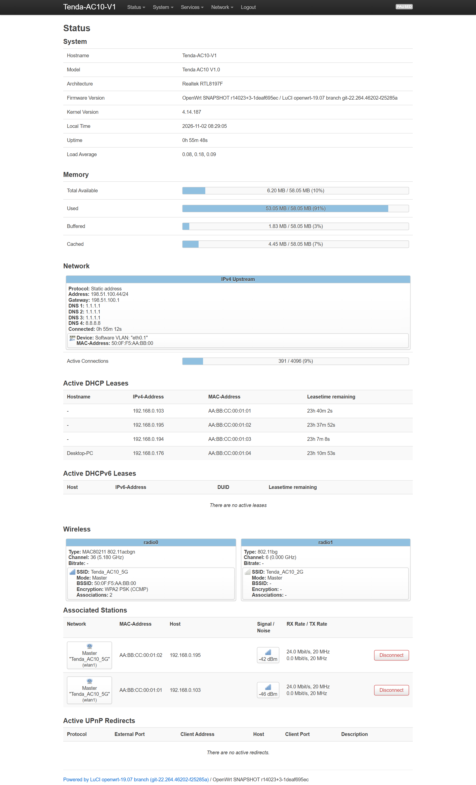
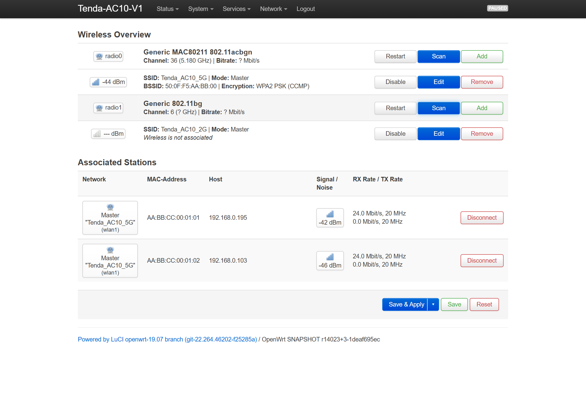
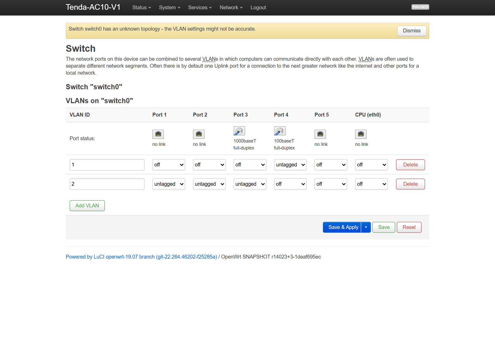
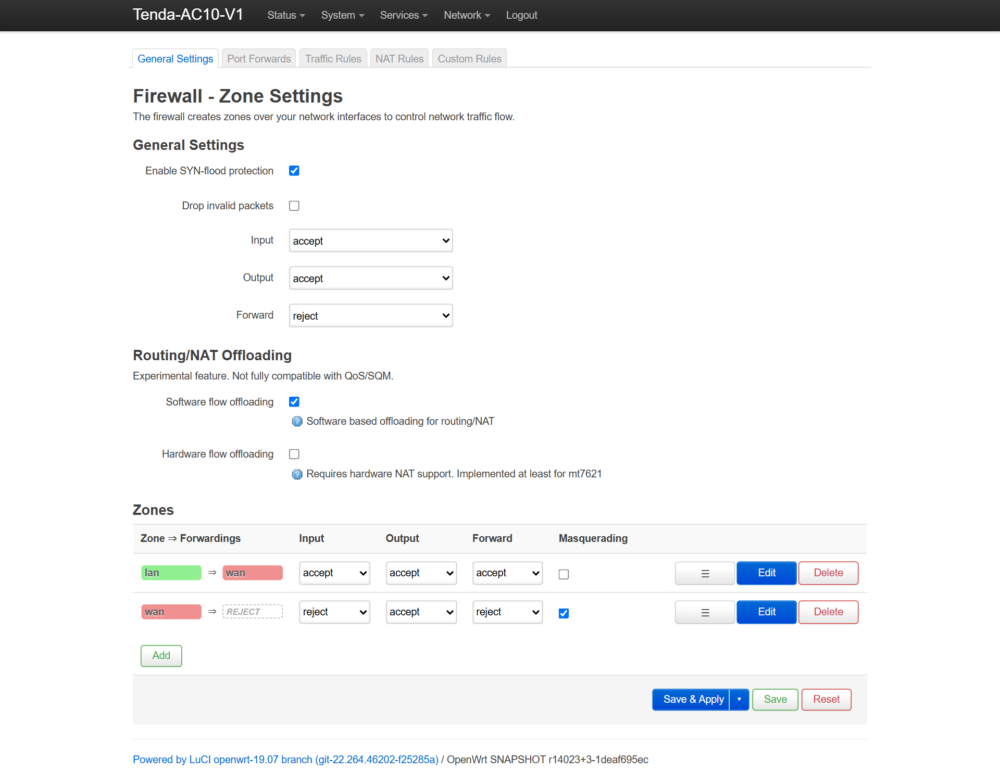

# Hybrid OpenWrt 4.14.187 Port: Architecture, Screenshots & 1-Click Setup (EN)

> **Navigation:** [Home (EN)](EN-Home) | [Русская версия](RU-Hybrid-OpenWrt-4.14-Port) | [Wiki Portal](Home)

**Hybrid OpenWrt 4.14.187 (`v4.14.187-r2-ac10-hybrid`)** pairs **OpenWrt 19.07 userland + LuCI** (`http://192.168.0.1`, Dropbear SSH, `fw3`, persistent `JFFS2` overlay) with a patched **Linux 4.14.187** kernel tailored to the Tenda AC10 V1.0's `RTL8197FS` SoC, `RTL8367RB` switch, and `RTL8822BE` 5 GHz PCIe radio.

---

## 1. Live LuCI Web Panel Screenshots

| System Overview (`Status -> Overview`) | 5 GHz `23 dBm` Wireless (`Network -> Wireless`) |
|---|---|
|  |  |

| `RTL8367RB` VLAN Switch (`Network -> Switch`) | Software Flow Offloading (`Network -> Firewall`) |
|---|---|
|  |  |

---

## 2. What's Fixed Out of the Box in `r2`

1. **Full-Power 5 GHz `RTL8822BE` (`Skyworth SE5003L1` RFE Type 6):**
   - Tenda left the `RTL8822BE` OTP eFuse blank (`0xFF`), causing unpatched `rtw88` to drop TX/RX by `-17 dB` (`RFE 0`) with `xtal_cap=0`. We binary-patched `rtw88_8822b.ko` ELF relocations to add `rfe_info[6]` (`rtw8822b_config_rfe_efem`, BB regs `0x82C/0x830/0x838/0x83C`), and `/bin/set-mib.sh` injects each unit's factory `HW_WLAN0_11N_XCAP` and MAC from `/dev/mtd1` on boot.
   - Default profile is locked to **`VHT20`, Channel `36`, `23 dBm` (200 mW)** (`ifname='wlan1'` pinned by PCIe path) for zero link drops — avoiding the B-cut RF register `0x33` poll timeout seen at 80 MHz (`VHT40`/`VHT80` remain selectable in LuCI).
2. **Simultaneous Wired + Wi-Fi Routing (`hwnat=0` + Software Flow Offloading):**
   - Enabling `rtl819x_hwnat` (`hwnat=1`) delivers `940 Mbps` wired NAT at `0.5%` CPU, but its ASIC TLU blackholes software-bridged Wi-Fi frames crossing `br-lan` (`wlan1 -> eth0.1`). Shipping `hwnat=0` + `firewall.flow_offloading='1'` (while keeping `dir842.asic.role='router'` and `fabric_autoreset=3`) gives **~350–500 Mbps** across wired and Wi-Fi together out of the box, with 1-command `echo 1 > /sys/module/rtl819x/parameters/hwnat` available for wired-only gigabit setups.
3. **Cold-Boot Cloned WAN MAC Sync (`wait_netif_mac`):**
   - `/etc/init.d/dir842-asic` waits for both `eth0.2` (LAN) and cloned `eth0.1` (`network.wan.macaddr`) before programming `gw_prog`.
4. **Odd WAN Port 3 & `GPIO 58` Switch Reset:**
   - `tenda-ac10-v1.dts` binds switch reset `<&gpio1 26 GPIO_ACTIVE_LOW>` (`GPIO 58`), paired with 9 MIPS32 LE `vmlinux` patches fixing odd `Port 3` WAN PVID upper-halfword shift and L2 masks.
5. **Apple iOS Encrypted DNS (RFC 9462 DDR) & WAN Socket Lockdown:**
   - Removed unrouted `ula_prefix` and set `dhcp_option '6,1.1.1.1,8.8.8.8,192.168.0.1'` for instant HTTP/3 QUIC DoH without iOS warnings; `uhttpd` and `dnsmasq` are isolated from `eth0.1`.
6. **Honest 2.4 GHz Note:**
   - 2.4 GHz uses the donor DIR-842 R1 `rtl8192cd.ko` module without `Skyworks SKY85303-11` PA tables, so 2.4 GHz range is short-room only. Use 5 GHz as your primary band.

---

## 3. Flashing & 1-Click Offline ISP Migration

1. Save a backup of your stock Tenda `RouterCfm.cfg` before flashing if your ISP locks to a cloned WAN MAC.
2. Flash **`tenda-ac10-v1-hybrid-openwrt-4.14-webupgrade.bin`** directly from the stock Tenda Web UI (`192.168.0.1`), OR run **`offline_autonomous_tools\Flash_Hybrid_OpenWrt_4.14_TFTP.bat`** as Administrator with Ethernet plugged into **LAN 1–3** while holding `RST/WPS` at power-on for 7–10 seconds.
3. Wait **90–120 seconds** on first boot while `80_mount_root` formats a clean `JFFS2` overlay on `mtd5`.
4. Plug your ISP cable into blue **WAN** and run **`offline_autonomous_tools\Configure_OpenWrt_ISP_WAN_and_WiFi.bat`** to migrate cloned WAN MAC, WAN IP/DNS, static DHCP leases, and Wi-Fi SSIDs/passwords over local SSH in 10 seconds.
