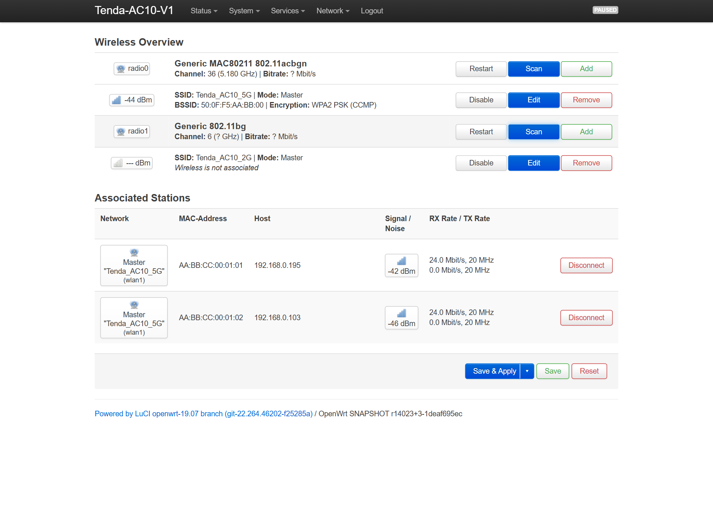
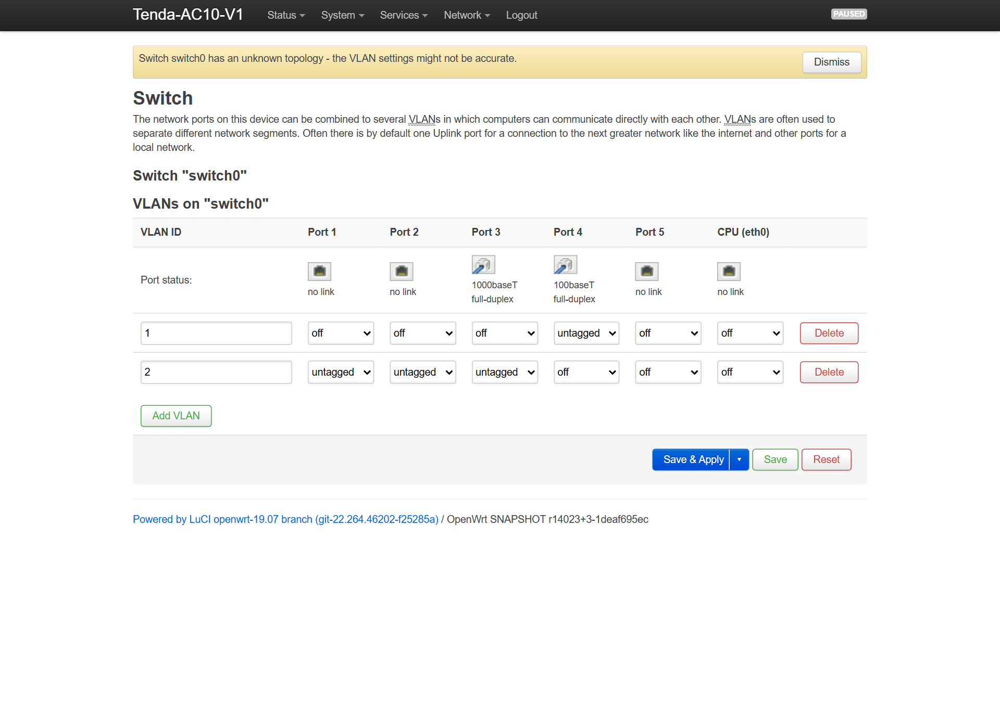
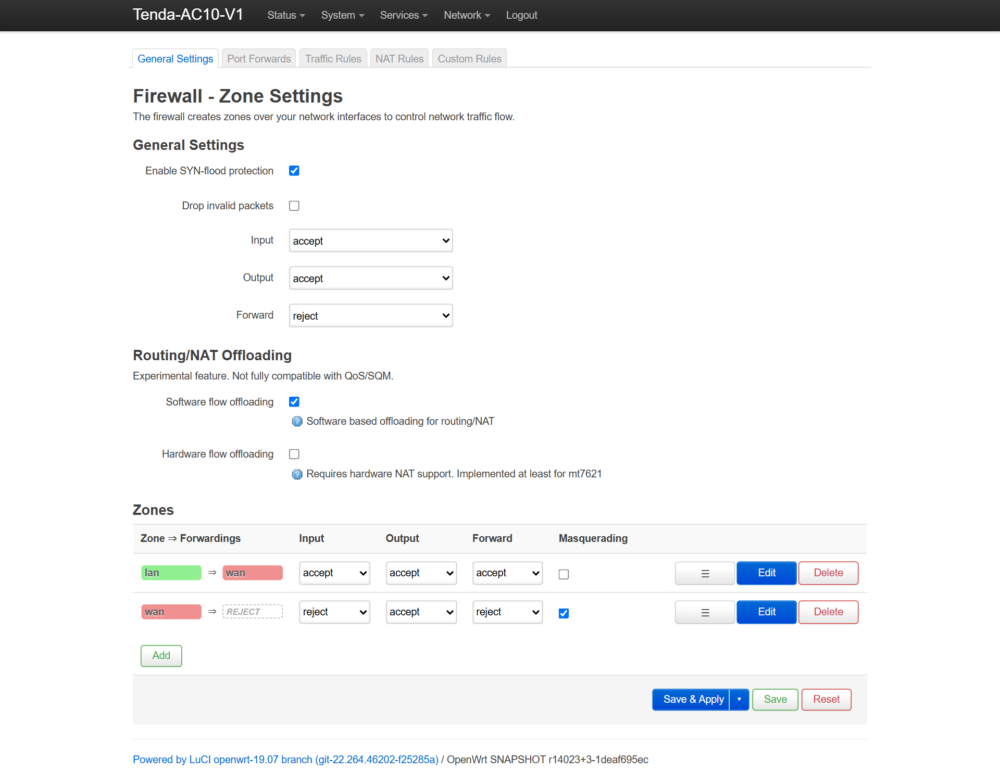

# Hybrid OpenWrt 4.14.187 для Tenda AC10 V1.0: устройство, скриншоты и автонастройка

> **Навигация:** [Главная (RU)](RU-Home) | [English Version](EN-Hybrid-OpenWrt-4.14-Port) | [Wiki Portal](Home)

Сборка **Hybrid OpenWrt 4.14.187 (`v4.14.187-r3-ac10-hybrid`)** совмещает привычное пользовательское окружение **OpenWrt 19.07 + LuCI** (`http://192.168.0.1`, SSH Dropbear, `fw3`, сохранение настроек в `JFFS2`) с пропатченным ядром **Linux 4.14.187** под процессор `RTL8197FS`, свитч `RTL8367RB` и радиомодуль 5 ГГц `RTL8822BE`.

---

## 1. Живая панель LuCI после прошивки

| Сводка (`Status -> Overview`) | Wi-Fi 5 ГГц `23 dBm` (`Network -> Wireless`) |
|---|---|
|  |  |

| Коммутатор `RTL8367RB` (`Network -> Switch`) | Flow Offloading (`Network -> Firewall`) |
|---|---|
|  |  |

---

## 2. Что реально починено в сборке `r2` (по сравнению со старыми портами)

1. **5 ГГц `RTL8822BE` с внешними усилителями `Skyworth SE5003L1` (`RFE Type 6`):**
   - На заводе в чипе не прожгли память OTP eFuse (там сплошные `0xFF`), поэтому обычный драйвер `rtw88` выключал внешние усилители (`-17 дБ` сигнала) и ставил `xtal_cap=0`. Мы пропатчили ELF-релокации модуля `rtw88_8822b.ko` под `RFE Type 6` (`0x82C/0x830/0x838/0x83C`), а скрипт `/bin/set-mib.sh` при каждом старте подтягивает из `/dev/mtd1` родную ёмкость кварца `HW_WLAN0_11N_XCAP` и заводской MAC.
   - По умолчанию выставлен стабильный профиль **`VHT20`, канал `36`, `23 dBm` (200 мВт)** — связь держится сутками без единого обрыва (на полосе 80 МГц ревизия чипа B-cut периодически ловила таймауты регистра `0x33`; при необходимости `VHT40`/`VHT80` переключаются в меню LuCI).
2. **Одновременная работа кабеля и Wi-Fi без «чёрной дыры» (`hwnat=0` + Software Flow Offloading):**
   - Фирменный `rtl819x_hwnat` при `hwnat=1` выдаёт `940 Мбит/с` по проводу при 0.5% CPU, но режет кадры беспроводных клиентов из моста `br-lan` (на телефонах висит «Подключено, без доступа к интернету»). Поэтому из коробки включён `Software Flow Offloading` при `hwnat=0` и аппаратном режиме свитча `role='router'` (`fabric_autoreset=3`) — это даёт честные **~350–500 Мбит/с** и по кабелю, и по Wi-Fi одновременно. А кому нужен чистый гигабит только по проводу, может в любой момент выполнить `echo 1 > /sys/module/rtl819x/parameters/hwnat`.
3. **Клонированный MAC провайдера не отваливается после ребута по питанию:**
   - В `/etc/init.d/dir842-asic` функция `wait_netif_mac()` теперь ждёт не только `eth0.2` (LAN), но и применения клонированного `network.wan.macaddr` на `eth0.1` перед вызовом `gw_prog`.
4. **Правильная распиновка нечётного порта WAN (`Port 3`) и `GPIO 58`:**
   - В `tenda-ac10-v1.dts` прописан сброс свитча `<&gpio1 26 GPIO_ACTIVE_LOW>` (`GPIO 58`), а в `vmlinux` внесены 9 бинарных патчей под нечётный `Port 3` WAN (включая сдвиг верхних 16 бит регистра PVID).
5. **Чистый DoH на iPhone / Mac (RFC 9462 DDR) и изоляция WAN:**
   - Убран `ula_prefix`, выставлен `dhcp_option '6,1.1.1.1,8.8.8.8,192.168.0.1'` — iOS сразу уходит на HTTP/3 DoH без жёлтого предупреждения о блокировке DNS. Службы `uhttpd` и `dnsmasq` закрыты от внешнего интерфейса `eth0.1`.
6. **Честный статус 2.4 ГГц:**
   - На 2.4 ГГц работает модуль `rtl8192cd.ko` от D-Link DIR-842 R1 без калибровочных таблиц усилителя `Skyworks SKY85303-11`, поэтому радиус 2.4 ГГц небольшой (в пределах комнаты). Как основную сеть используйте 5 ГГц.

---

## 3. Прошивка и перенос настроек провайдера в 1 клик

В релизе лежат три образа и архив готовых скриптов `Tenda_AC10_V1_Offline_Autonomous_Toolkit.zip`:

| Файл | Назначение |
|---|---|
| **`tenda-ac10-v1-hybrid-openwrt-4.14-webupgrade.bin`** | Прямая прошивка из заводского веб-меню Tenda (`192.168.0.1` -> Обновление ПО, с шапкой `trx2` `0x00030028`). |
| **`tenda-ac10-v1-hybrid-openwrt-4.14-factory.bin`** | Прошивка и раскирпичивание по TFTP через загрузчик (`192.168.1.6:69`, односегментный `cs6c`, защищён от бага `$s7=0`). |
| **`tenda-ac10-v1-hybrid-openwrt-4.14-sysupgrade.bin`** | Обновление поверх работающей OpenWrt через LuCI или `sysupgrade`. |

### Быстрый сценарий с автопереносом настроек провайдера:
1. Сохраните со стоковой прошивки резервную копию настроек `RouterCfm.cfg`.
2. Прошейте роутер через браузер (`webupgrade.bin`) или запустите от имени Администратора **`offline_autonomous_tools\Flash_Hybrid_OpenWrt_4.14_TFTP.bat`** (кабель строго в **LAN 1–3**, зажать `RST/WPS` при включении питания на 7–10 с).
3. Подождите **90–120 секунд** при первом включении (скрипт `80_mount_root` отформатирует чистый раздел `JFFS2`).
4. Вставьте кабель провайдера в синий порт **WAN** и запустите **`offline_autonomous_tools\Configure_OpenWrt_ISP_WAN_and_WiFi.bat`** — скрипт за 10 секунд перенесёт из `RouterCfm.cfg` клонированный MAC, настройки WAN, DNS, статические привязки DHCP и ваши сети Wi-Fi.
